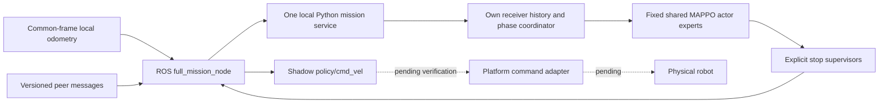

# Common execution architecture

Each robot owns one instance of this pipeline. Training and the centralized
critic are absent from the control path. Synthetic impairment queues and the
global physical state exist only in test harnesses. Runtime actors see their own
state and accepted peer packets. No node commands the other robots.

The policy is six independently trained shared MAPPO experts with local routing;
it is not one jointly trained end-to-end network. Alignment linear velocity is
fixed to zero by the stage action interface. A local terminal stop latches zero
after arrival and settling. An optional predictive translation gate can veto
motion using available peer estimates and configured circular footprints. It
does not steer, is not trained, and is not a formal safety guarantee.

The delivery gate is phase-specific: missing peer estimates veto translation in
FORM; during MOVE/HOLD, available point-trajectory risk is checked while missing
information remains the learned policy/peer-timeout responsibility. Current
position-error bounds enter the FORM prediction, not the MOVE point prediction.
This tradeoff avoids indefinite independent stops that deform a translating team.
It cannot certify collision freedom under unobserved motion or long partitions.

The modeled trajectory samples a rate/acceleration-limited unicycle over 1 s,
with 0.1 s samples, and constant-twist peer predictions from accepted messages.
If predicted circular clearance minus the selected uncertainty contribution
falls below 0.03 m, translation is vetoed; policy yaw is retained. Out-of-profile
own speed requests zero on both channels. These choices apply to the synthetic
profile, not yet to rectangular, legged or heterogeneous physical robots.

Deadline is 300 s in nominal/good/moderate and 420 s in severe. The longer severe
budget is explicit, not an unexplained improvement in the learned policy. Initial
arrival must occur within that budget; continued terminal hold is then observed
for at least 60 s. Watchdogs remain active after arrival.
